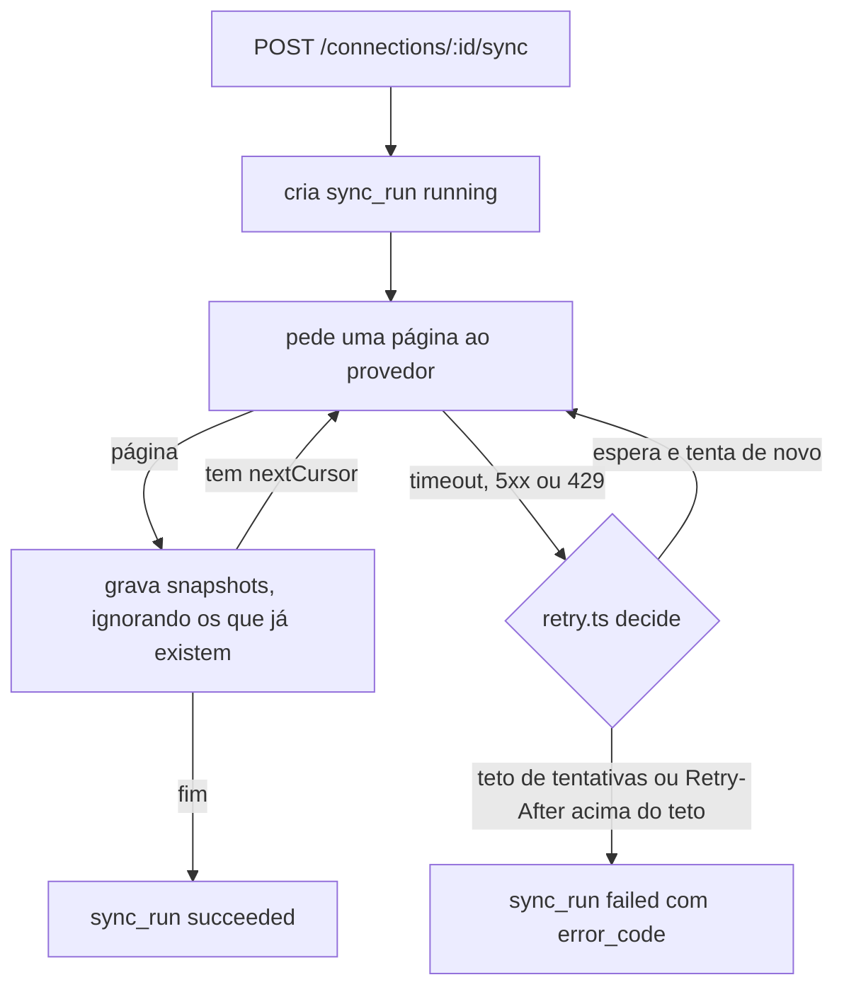
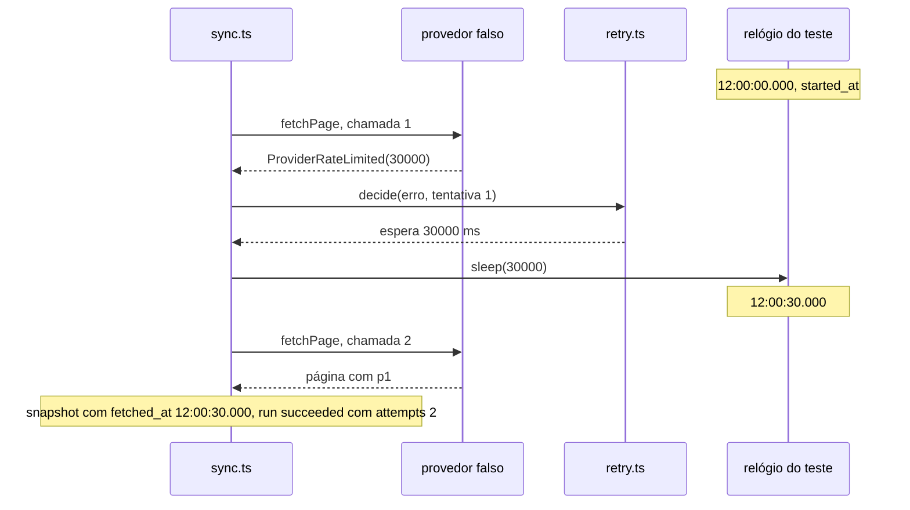
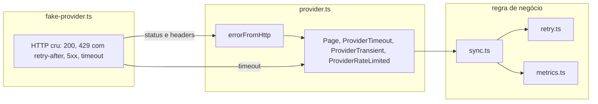

# Conty. Métricas das redes do criador

API que recebe uma conexão já autorizada com uma rede (Instagram, TikTok, YouTube ou X) e sincroniza as métricas dos posts. O provedor é simulado. O serviço sobrevive a timeout, resposta duplicada e limite de taxa, e uma janela que se sobrepõe à anterior não conta o mesmo post duas vezes.

## Visão rápida

Cada item de "Como avaliamos", onde a regra vive e o teste em `test/sync.test.ts` que prova.

| Como avaliamos | Onde está a regra | Teste que prova |
| --- | --- | --- |
| O mesmo snapshot não duplica número, nem quando a janela se sobrepõe à anterior. | `src/metrics.ts`, chave em `src/db.ts` | "não conta o post de novo quando a janela seguinte reencontra o mesmo snapshot" |
| Falha transitória tem retry com limite, não loop infinito. | `src/retry.ts`, laço em `src/sync.ts` | "para no teto de tentativas quando o provedor sempre dá timeout" |
| 429 espera o prazo que o provedor mandou, e a espera não passa do teto configurado. | `src/retry.ts` | "espera exatamente o Retry-After e registra o instante da busca depois da espera" e "não espera menos nem tenta de novo quando o Retry-After passa do teto" |
| Dá para saber quando a métrica foi buscada. | `src/sync.ts`, colunas em `src/db.ts` | "separa captured_at do provedor de fetched_at do serviço e lista as execuções" |
| A fronteira entre o provedor falso e a regra de negócio está legível. | `src/provider.ts` | "para no teto de tentativas quando o provedor sempre dá 5xx" |

## Como rodar

Node 22 ou mais novo.

```bash
npm install
npm test
npm run typecheck
npm start
```

A API sobe em `http://127.0.0.1:3004` e grava em `data/metricas.sqlite`. `PORT` e `DB_PATH` mudam isso (veja `.env.example`). Na subida, `src/seed.ts` cadastra estas conexões do criador `crt_ana`. O token escolhe o cenário do provedor da demo:

| Conexão | Plataforma | Token | O provedor faz |
| --- | --- | --- | --- |
| `con_ana_instagram` | instagram | `tok_ok` | responde normal |
| `con_ana_tiktok` | tiktok | `tok_429` | 429 com `Retry-After: 2` na primeira chamada |
| `con_ana_youtube` | youtube | `tok_429_longo` | 429 com `Retry-After: 120` sempre |
| `con_ana_x` | x | `tok_503` | 503 sempre |

O token é fictício. Não há OAuth. Ele fica no banco e nunca volta numa resposta.

## Fluxo



## Endpoints

| Método e caminho | Corpo | Sucesso |
| --- | --- | --- |
| `POST /connections` | `{ "creator_id", "platform", "token" }` | 201 |
| `POST /connections/:id/sync` | `{ "from", "to" }` (ISO 8601) | 201 |
| `GET /connections/:id/sync-runs` | | 200 |
| `GET /connections/:id/posts` | | 200 |
| `GET /creators/:id/totals` | | 200 |

A sincronização sempre devolve `201` com a execução (`sync_run`). Se o provedor não cooperou, a execução vem com `status: "failed"`, `error_code` e `last_error`. O erro é do provedor, não do pedido.

Os erros de pedido têm a forma `{ "error": "mensagem", "code": "codigo" }` e são checados nesta ordem:

```text
422 corpo         invalid_body, platform_invalid, from_required, from_invalid, to_required, to_invalid, window_invalid
404 connection_not_found
```

[`EXEMPLOS.md`](EXEMPLOS.md) traz o caminho feliz e cada falha com curl e as respostas reais.

## Idempotência

O provedor devolve contadores acumulados: "o post tinha 1000 visualizações às 12h de 01/10". Cada resposta é um snapshot do post num instante. A identidade do snapshot é o post mais o instante de captura do provedor (`captured_at`), e o banco amarra isso com `PRIMARY KEY (post_id, captured_at)`. O post é único por `UNIQUE (connection_id, external_post_id)`.

- Snapshot repetido, na mesma resposta ou em outra janela, cai em `INSERT OR IGNORE` e não muda nada. O primeiro registro vence.
- O total de um post é o snapshot de maior `captured_at`, nunca a soma dos snapshots. Isso vale mesmo se o snapshot antigo chegar depois do novo.
- O total do criador é a soma do último snapshot de cada post, em todas as conexões.

Exemplo do teste "usa o snapshot mais recente como total, sem somar os acumulados":

```text
janela A  01/10 a 03/10   p1 capturado 02/10 views 100   grava (p1, 02/10)
janela B  02/10 a 06/10   p1 capturado 02/10 views 100   ignora, a chave (p1, 02/10) já existe
                          p1 capturado 04/10 views 160   grava (p1, 04/10)

metric_snapshots de p1    (p1, 02/10) 100
                          (p1, 04/10) 160
total de p1               160, o de maior captured_at. Não é 100 + 100 + 160.
```

Duas sincronizações simultâneas da mesma conexão também são seguras. A gravação de uma página é uma transação síncrona, e a chave do snapshot garante o resultado mesmo se duas gravarem o mesmo.

Se uma página falha depois de outras já gravadas, as gravadas ficam. A próxima sincronização refaz o trecho sem duplicar.

## 429, timeout e erro 5xx

O provedor falso traduz a resposta HTTP para três erros tipados em `src/provider.ts` (`ProviderTimeout`, `ProviderTransient`, `ProviderRateLimited` com `retryAfterMs`). O sync só conhece esses três. A política vive como dado em `src/retry.ts`:

```ts
{ maxAttempts: 4, maxRetryAfterMs: 60_000, backoffMs: [500, 1000, 2000] }
```

`decide()` é uma função pura que olha o erro e o número da tentativa:

| Situação | Resultado |
| --- | --- |
| 429 com `Retry-After` até o teto | espera exatamente o `Retry-After` e tenta de novo |
| 429 com `Retry-After` acima do teto | para na hora, sem esperar, `error_code: retry_after_exceeds_cap` |
| 429 sem `Retry-After`, timeout ou 5xx | espera o backoff da tentativa e tenta de novo |
| tentativa número `maxAttempts` falhou | para, `error_code: attempts_exhausted` |

Um `Retry-After` acima do teto não vira uma espera menor. O serviço não finge que respeitou o provedor. Para com motivo claro.

Exemplo com `Retry-After: 30`: a primeira chamada dá 429, o serviço chama `sleep(30000)`, a segunda chamada responde. No teste, `sleep` avança um relógio controlado, então `started_at` é `12:00:00.000`, `finished_at` é `12:00:30.000` e o `fetched_at` dos snapshots é `12:00:30.000`. O teste "espera exatamente o Retry-After e registra o instante da busca depois da espera" prova isso.



`maxAttempts` conta chamadas por página. O `attempts` de `sync_runs` é o total de chamadas ao provedor na execução. `Retry-After` só em segundos, não em data HTTP.

## Quando a métrica foi buscada

Cada snapshot tem `captured_at` (instante informado pelo provedor) e `fetched_at` (relógio do serviço, depois de qualquer espera). Cada execução grava `window_from`, `window_to`, `started_at`, `finished_at`, `status`, `attempts` e o erro. `GET /connections/:id/posts` mostra os dois instantes. `GET /connections/:id/sync-runs` mostra as execuções.

Um post da resposta real em [`EXEMPLOS.md`](EXEMPLOS.md). O provedor capturou em 03/10 e o serviço buscou em 11/10:

```json
{"external_post_id":"instagram_post_1","views":2000,"likes":20,"comments":0,"shares":0,"captured_at":"2026-10-03T12:00:00.000Z","fetched_at":"2026-10-11T08:18:44.686Z","snapshots":2}
```

Os testes controlam o relógio e a espera passando `now` e `sleep` para `createApp(db, { provider, now, sleep, policy })`.

## Onde está cada regra

```text
src/
├── app.ts            # rotas e validação do corpo
├── sync.ts           # runSync: páginas, retentativa, registro da execução
├── retry.ts          # RetryPolicy e decide(): espera, teto e parada
├── metrics.ts        # grava snapshots (idempotente) e calcula totais
├── provider.ts       # interface MetricsProvider e erros tipados: a fronteira
├── fake-provider.ts  # provedor simulado: fila de respostas e cenários da demo
├── db.ts             # schema SQLite; UNIQUE e CHECK amarram o estado
├── seed.ts           # conexões da demo
└── index.ts          # sobe o servidor
test/sync.test.ts
```

A regra de negócio (`sync.ts`, `retry.ts`, `metrics.ts`) importa só `provider.ts`. O formato HTTP do provedor fica em `errorFromHttp` e no falso.



## O que ficou de fora

- OAuth, renovação de token e provedor real, como pede o enunciado.
- Agendamento: a sincronização roda quando alguém chama o endpoint.
- Autenticação da API.
- Correção de snapshot: se o provedor reenviar o mesmo `captured_at` com números diferentes, o primeiro vence.
- Campanha: o total é por criador. Agrupar por campanha exigiria ligar post a campanha, que o enunciado não descreve.

## Com mais tempo

- Travar uma execução por conexão, para não gastar cota do provedor com duas buscas iguais ao mesmo tempo. Hoje o resultado fica correto, mas as duas buscam.
- Jitter no backoff.
- Aceitar `Retry-After` como data HTTP.
- Retomar do último cursor gravado em vez de refazer a janela.

## Uso de IA

- Feito com IA (Claude Code): o modelo de dados (chave do snapshot, `captured_at` separado de `fetched_at`, `sync_runs`), o provedor falso e a fronteira de erros tipados, a política de retry, o código, os testes, a execução com curl de `EXEMPLOS.md` e este README, incluindo os diagramas e a tabela de visão rápida. Os testes de falha foram escritos antes da implementação e vistos falhando contra um sync ingênuo, sem retry e sem `INSERT OR IGNORE`. A revisão não achou bug além disso.
- Revisado por mim: o modelo de snapshot com chave no post e no instante de captura, o total pelo snapshot mais recente em vez da soma, a política de retry (teto de tentativas por página e Retry-After acima do teto encerrando a execução sem esperar menos), a fronteira entre o provedor falso e a regra de negócio, os testes de 429 com relógio controlado e este README.
